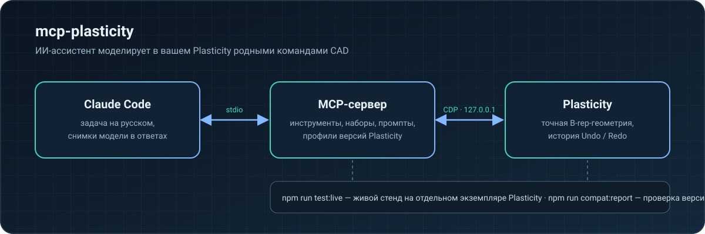

# mcp-plasticity

MCP-сервер для [Plasticity](https://www.plasticity.xyz/): ИИ-ассистент (в первую очередь Claude Code) моделирует, измеряет и экспортирует детали в установленном у вас Plasticity — через родные команды CAD, с историей Undo/Redo и точной B-rep-геометрией.

Автор: **Куликов Даниил** ([kad-xyz](https://github.com/kad-xyz))



## Что умеет

- **Моделирование родными командами Plasticity**: примитивы, Boolean, скругления и фаски, вытягивание, вращение, sweep и loft, работа с кривыми, поверхностями, гранями и рёбрами, массивы и зеркалирование. Все изменения попадают в историю документа — работает Undo/Redo.
- **Точные измерения**: габариты, объёмы и площади, расстояния, зазоры, кривизна, уклоны, пересечения тел — по B-rep, а не по сетке.
- **Готовые конструктивные элементы**: отверстия, зенковки, цековки, карманы под гайки и термовставки, бобышки, рёбра, вентиляционные решётки, защёлки, шарниры, соединения корпусов.
- **Модель видит результат**: `plasticity_view` возвращает снимки вьюпорта прямо в ответе — с нескольких стандартных видов, с вписыванием только видимых тел; камера и рабочая плоскость пользователя после съёмки восстанавливаются.
- **Документы и обмен**: открытие и сохранение `.plasticity`, импорт и экспорт STEP, Parasolid, STL, OBJ, 3MF, SVG.
- **Печать и прочность** (по желанию): ориентация и разрезка под стол принтера, печатные резьбы, проверка крепежа и прочностные оценки.

## Требования

- macOS на Apple Silicon
- Plasticity 26.1.3 в `/Applications/Plasticity.app` (другие версии — см. «Совместимость»)
- Node.js 24 или новее
- Claude Code

## Установка

```sh
git clone https://github.com/kad-xyz/mcp-plasticity.git
cd mcp-plasticity
npm install
npm run start:plasticity   # запускает Plasticity с локальным отладочным портом
npm run setup:claude       # ставит плагин в Claude Code
```

После `setup:claude` перезапустите Claude Code. Попросите ассистента вызвать `plasticity_list_windows`, затем `plasticity_connect` с нужным окном.

`start:plasticity` не закрывает уже запущенный Plasticity: если он открыт без отладочного порта, сохраните работу, закройте его и запустите команду снова. Порт слушает только `127.0.0.1`.

## Как работать с ассистентом

- **Компактный режим** (по умолчанию): модели сразу видны основные инструменты, остальные — через `plasticity_call` с каталогом (`toolName: "catalog"` и `query`). Каталог ищет по словам, подсказывает ближайшие имена и показывает примеры вызова.
- **Наборы инструментов**: `plasticity_toolsets` показывает группы (кривые, тела, поверхности, измерения, рецепты…), `plasticity_enable_toolset` открывает группу целиком — клиент получает её инструменты со схемами.
- **Сценарии**: MCP-промпты `plasticity_new_part`, `plasticity_enclosure`, `plasticity_modify_part`, `plasticity_prepare_print`, `plasticity_inspect` и `plasticity_model_from_reference` задают проверенный порядок работы.
- **Понятные ошибки**: частые ошибки заканчиваются строкой `Next step:` с конкретным действием, ошибки аргументов — коротким списком полей.

Единицы — миллиметры и градусы. Ссылки на грани и рёбра привязаны к ревизии документа: после каждого изменения их нужно перечитать.

## Совместимость с версиями Plasticity

Сервер определяет версию Plasticity и выбирает профиль совместимости. `plasticity_connect` и `plasticity_diagnose` сообщают версию и статус (`supported` / `untested`).

```sh
npm run compat:report -- --isolated   # проверяет, есть ли в установленном Plasticity всё, что нужно серверу
```

Отчёт перечисляет отсутствующие фабрики, команды и пути редактора и затронутые инструменты. Процедура переноса на новую версию — в [docs/compat.md](docs/compat.md).

## Разработка

```sh
npm test
npm run typecheck
npm --prefix workbench test
npm --prefix workbench run typecheck
```

### Живой регрессионный стенд

Стенд запускает отдельный экземпляр Plasticity с временным профилем и гоняет проверки через настоящий MCP-сервер. Ваше окно Plasticity и его документы он не трогает: работает только в собственном документе `live-runs/harness-document.plasticity`, а если ваш процесс Plasticity исчезнет во время прогона — выведет предупреждение.

```sh
npm run test:live                       # быстрый уровень: ключевые проверки за несколько секунд
npm run test:live:full                  # все scripts/verify-*-live.ts, долго
npm run test:live -- --only box-primitive,fillet-chamfer
npm run test:live -- --update-baseline  # принять текущий прогон как эталон
```

Результаты — в `live-runs/<время>-<уровень>/`: `report.md` (таблица и изменения относительно эталона), `report.json`, `checks/<проверка>/`, `instance.log`. Эталон `live-runs/baseline-<уровень>.json` обновляется только вручную и только для прогона без ошибок.

Коды возврата: `0` — всё прошло и нет регрессий; `1` — есть падения, регрессии или прогон прерван; `2` — стенд не смог запуститься.

### Workbench (по желанию)

Локальный веб-интерфейс для просмотра модели, таблиц измерений и замечаний с планшета:

```sh
npm run start:workbench
npm --workspace workbench run open:owner
```

Для доступа с планшета в той же сети — `npm run start:workbench -- --lan`. Не открывайте его в интернет.

## Безопасность и ограничения

- Изменения выполняются последовательно и проверяются по ревизии документа; устаревшие ссылки отклоняются.
- После таймаута или обрыва соединения сначала вызывается `plasticity_reconcile` — повторять или отменять операцию вслепую нельзя.
- Отправка задания на печать и её запуск — отдельные шаги; запуск только после явного подтверждения пользователя.
- Прочностные инструменты дают оценочные расчёты, а не сертифицированный инженерный анализ.
